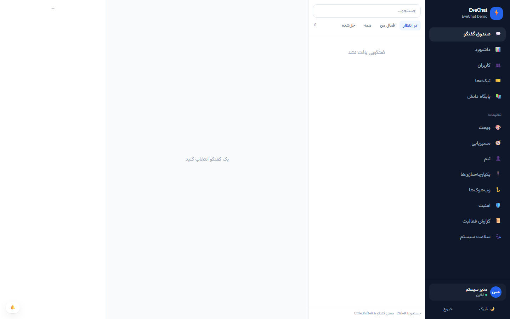
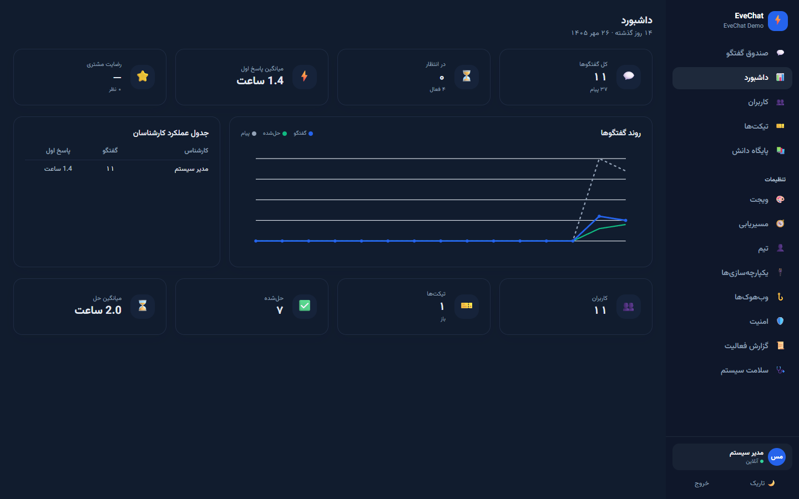
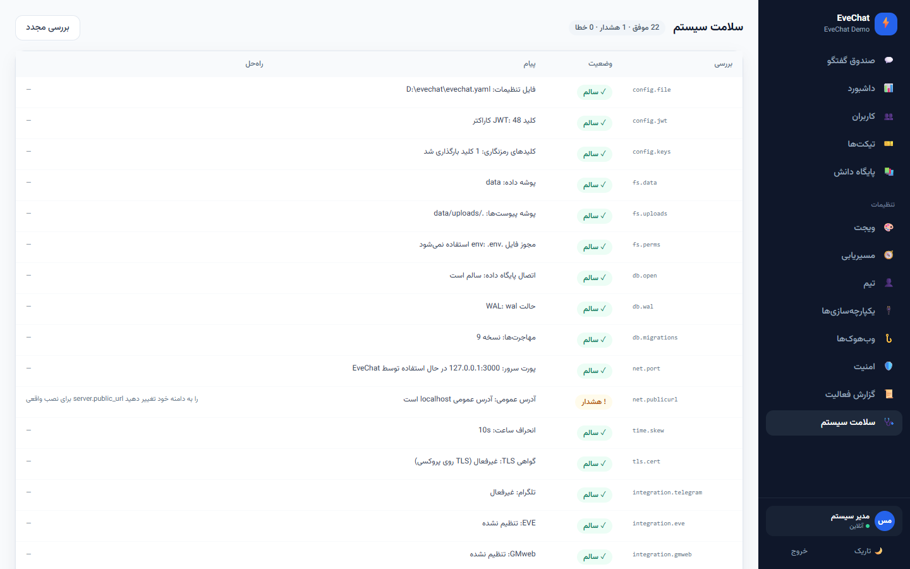
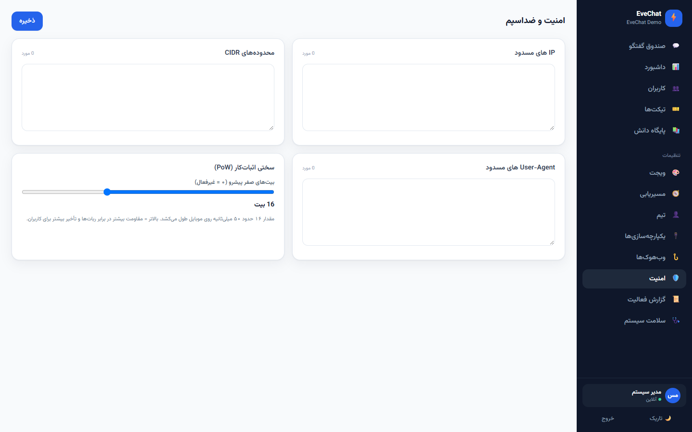

<div dir="rtl">

# ⚡ EveChat

**چت پشتیبانی آنی و خودمیزبان** — یک باینری استاتیک Go، پایگاه داده SQLite تعبیه‌شده، ویجت قابل‌جاسازی و پنل فارسی راست‌به‌چپ.

[](https://github.com/aibedini/evechat/releases)
[](https://github.com/aibedini/evechat/actions/workflows/ci.yml)
[](LICENSE)

EveChat برای تیم‌های پشتیبانی فارسی طراحی شده است: بدون وابستگی به سرویس ابری، بدون CDN، قابل نصب روی سرور ایران، با رمزنگاری پیام‌ها در حالت سکون و امکان نصب کاملاً آفلاین.

## نگاهی به محصول

| صندوق گفتگو | داشبورد (تاریک) |
|---|---|
|  |  |

| ویجت روی سایت | سلامت سیستم | امنیت و ضد‌اسپم |
|---|---|---|
|  |  |  |

تصاویر بیشتر در [docs/screenshots](docs/screenshots)؛ برای بازتولید: `node scripts/screenshots.mjs`.

**تازه در ۱.۲.۰:**

- **کانال‌ها (وبهوک دوطرفه):** دریافت پیام از CRM/تلگرام/درگاه پیامک با نگاشت
  JSONPath، ده گام پردازش، نردبان retry برای خروجی و بازرس ۴۸ ساعته —
  [docs/CHANNELS.fa.md](docs/CHANNELS.fa.md).
- **واکنش‌گرایی کامل:** ویجت با رفع باگ کیبورد موبایل (`visualViewport`)،
  `dvh` و `safe-area`؛ پنل با سایدبار کشویی، صندوق تک‌ستونی، جدول→کارت و
  Kanban→تب — [docs/RESPONSIVE.md](docs/RESPONSIVE.md).
- **صفحه‌ی نمایش (`/wallboard`):** تلویزیون اتاق پشتیبانی با توکن فقط‌خواندنی و
  بدون محتوای پیام — [docs/WALLBOARD.fa.md](docs/WALLBOARD.fa.md).
- **صفحه‌های دمو:** `/demo`، `/demo/split`، `/demo/devices`، `/demo/events`
  (فقط لوکال) — [docs/DEMO.fa.md](docs/DEMO.fa.md).

---

## نصب در ۶۰ ثانیه

```bash
curl -fsSL https://raw.githubusercontent.com/aibedini/evechat/main/install.sh | sudo bash
```

نصب‌کننده در ترمینال یک **منوی تعاملی انگلیسی** (نصب، ارتقا، دامنه و SSL، پروکسی nginx، وضعیت، حذف) نشان می‌دهد. آخرین نسخه را دانلود می‌کند، checksum را بررسی می‌کند، کاربر سرویس می‌سازد، کلیدهای امنیتی را در `.env` می‌نویسد، سرویس systemd را راه می‌اندازد و در پایان **آدرس پنل، ایمیل، رمز عبور و کلید پروژه** را چاپ می‌کند. پورت ۳۰۰۰ اگر اشغال باشد، خودش پورت آزاد پیشنهاد می‌دهد و به nginx/EVE کاری ندارد.

گزینه‌های پرکاربرد:

```bash
curl -fsSL .../install.sh | sudo bash -s -- --version v1.1.0 --dir /opt/evechat --port 8080
curl -fsSL .../install.sh | sudo bash -s -- --no-systemd
curl -fsSL .../install.sh | sudo bash -s -- --base-url https://mirror.example.ir/evechat   # شبکه محدود
curl -fsSL .../install.sh | sudo bash -s -- --uninstall                                   # داده‌ها حفظ می‌شوند
```

### دامنه و SSL بدون نوشتن پورت

پورت از `server.port` خوانده می‌شود؛ لازم نیست دوباره آن را وارد کنید:

```bash
sudo evechat domain set chat.example.com          # اتصال دامنه + vhost
sudo evechat domain ssl --email you@example.com   # دریافت/تمدید Let's Encrypt
sudo evechat domain status                        # دامنه، پورت، گواهی، سلامت
```

در نصب‌کننده هم:

```bash
sudo install.sh --configure-domain --domain chat.example.com
sudo install.sh --configure-domain --ssl --email you@example.com
```

### داکر (بدون build)

```bash
cp .env.example .env       # EVECHAT_AUTH__JWT_SECRET و EVECHAT_ENCRYPTION_KEY_V1 را پر کنید
docker compose -f docker-compose.quick.yml up -d
```

### نصب آفلاین (بدون اینترنت)

```bash
make bundle                # روی ماشین متصل به اینترنت
tar xzf evechat-offline-*.tar.gz && cd evechat-offline-*
sudo ./install-offline.sh
```

### ساخت از سورس

```bash
make build    # ویجت + پنل + ویزارد نصب + باینری؛ سقف اندازه ویجت را هم بررسی می‌کند
make test
```

---

## راه‌اندازی اولیه

دو مسیر وجود دارد؛ هر دو یکسان کار می‌کنند:

**۱) ویزارد وب** — پس از اجرا، مرورگر را روی `http://SERVER:3000` باز کنید. اگر نصب کامل نشده باشد به `/setup` هدایت می‌شوید: پنج گام (خوش‌آمد + بررسی پیش‌نیازها، حساب مدیر، پروژه، یکپارچه‌سازی‌ها، پایان) و سپس ورود مستقیم به صندوق گفتگو.

> برای نصب از راه دور، توکن نصب در خروجی سرور (و در فایل `<data>/setup-token.txt`) چاپ می‌شود و باید در گام اول وارد شود. این محافظ جلوی تصاحب نصب توسط مهاجم را می‌گیرد.

**۲) ویزارد CLI**

```bash
sudo -u evechat /opt/evechat/evechat setup
```

گزینه‌ها: `--non-interactive --json` برای نصب خودکار (مناسب install.sh و CI)، `--admin-email`، `--admin-password`، `--project-name`، `--domains`، `--port`، `--public-url`.

---

## افزودن ویجت به سایت

```html
<script>
  window.EveChat = {
    projectKey: "pk_...",
    apiUrl: "https://chat.example.com",
    visitor: {
      name: "مریم",
      mobile: "09121234567",
      metadata: { eve_user_id: "u_123", eve_reseller_id: "reseller_abc" },
      subscription: { plan: "pro", expiry: "2027-01-01" }
    },
    locale: "fa",
    position: "bottom-left",
    theme: "auto",          // auto | light | dark
    font: "vazirmatn"       // vazirmatn | inherit | none
  };
</script>
<script async src="https://chat.example.com/widget.js"></script>
```

- **وردپرس:** پوشه `wordpress/evechat` را در `wp-content/plugins` بگذارید و در *تنظیمات ← EveChat* کلید پروژه را وارد کنید. با ووکامرس، شناسه سفارش و ارزش مشتری هم ارسال می‌شود.
- **EVE:** از `metadata` برای شناسه کاربر، نمایندگی و اشتراک استفاده کنید؛ قوانین مسیریابی می‌توانند بر اساس آن‌ها تصمیم بگیرند.
- **حالت دستوری صف‌شده:** `window.ec('open')`، `ec('identify', {...})`، `ec('setVariable','utm_source','google')`.

---

## پیکربندی

ترتیب اولویت: **پیش‌فرض‌ها → `evechat.yaml` → متغیرهای محیطی**. متغیرها با پیشوند `EVECHAT_` و `__` برای تودرتویی: `EVECHAT_SERVER__PORT=3000`.

| کلید | پیش‌فرض | توضیح |
|---|---|---|
| `server.host` / `server.port` | `0.0.0.0` / `3000` | آدرس شنود |
| `server.public_url` | `http://localhost:3000` | آدرس عمومی، مبنای CORS و کد embed |
| `server.trust_proxy` | `false` | پشت nginx/Caddy مقدار `true` شود |
| `server.trusted_proxies` | `127.0.0.1/32` و `::1/128` | فقط اتصال مستقیم از این شبکه‌ها می‌تواند `X-Forwarded-For` بفرستد |
| `database.path` | `/data/evechat.db` | فایل SQLite |
| `storage.uploads_dir` | `/data/uploads` | پوشه پیوست‌ها |
| `auth.jwt_secret` | — | **الزامی**، فقط از محیط |
| `encryption.current_version` | `1` | نسخه کلید فعال |
| `security.pow_difficulty` | `16` | سختی اثبات‌کار (۰ = غیرفعال) |
| `security.messages_per_conversation_per_min` | `30` | سقف پیام در دقیقه |
| `metrics.enabled` / `metrics.token` | `false` / — | خروجی Prometheus |
| `audit.retention_days` | `180` | نگهداری گزارش فعالیت |
| `log.file` / `log.max_size_mb` | — / `50` | چرخش لاگ داخلی |
| `telegram.*` | خاموش | ربات پشتیبانی |
| `smtp.*` | خاموش | کانال ایمیل |
| `ai.enabled` | `false` | دستیار مبتنی بر پایگاه دانش |
| `security.blocked_ips` | — | لیست سیاه (قابل تغییر از پنل) |

کلیدهای رمزنگاری فقط از محیط خوانده می‌شوند: `EVECHAT_ENCRYPTION_KEY_V1` … `V9` (base64 از ۳۲ بایت).

جدول کامل: [docs/CONFIG.fa.md](docs/CONFIG.fa.md)

اجرا کنار سرور EVE (پورت، nginx، CSP، عیب‌یابی): [docs/DEPLOY_WITH_EVE.fa.md](docs/DEPLOY_WITH_EVE.fa.md)

---

## یکپارچه‌سازی‌ها

- **تلگرام:** توکن BotFather را در `EVECHAT_TELEGRAM__BOT_TOKEN` بگذارید، `enabled` را روشن کنید و webhook خودکار ثبت می‌شود. پاسخ با Reply داخل تلگرام به گفتگو برمی‌گردد؛ دکمه‌های «بستن گفتگو» و «ارجاع به پشتیبان» هم کار می‌کنند.
- **EVE:** `integrations.eve.base_url` و `api_key`؛ با فعال کردن `require_signature` امضای HMAC زمینه کاربر بررسی می‌شود.
- **GMweb:** `integrations.gmweb.base_url` و `api_key`؛ پیامک ورودی به گفتگوی همان شماره متصل می‌شود.
- **ایمیل:** `smtp.host/port/username/password/from_email`؛ قالب‌های فارسی برای چت جدید، پشتیبان‌گیری روزانه و بازیابی رمز.
- **هوش مصنوعی:** `ai.enabled=true` و `ai.claude_api_key`؛ فقط از مقالات پایگاه دانش پاسخ می‌دهد و در صورت تردید `NEED_HUMAN` را برمی‌گرداند و پرونده را به انسان می‌سپارد.

---

## پشتیبان‌گیری و بازیابی

```bash
# آنلاین و امن با WAL (فقط دیتابیس)
evechat backup /backup/evechat-$(date +%F)

# همراه پیوست‌ها و manifest
evechat backup /backup/evechat-$(date +%F) --with-uploads --keep 14

# بازبینی و سپس بازیابی (سرور باید متوقف باشد)
evechat restore /backup/evechat-2026-10-18.tar.gz --dry-run
sudo systemctl stop evechat && evechat restore /backup/evechat-2026-10-18.tar.gz
```

- پیش از جایگزینی، نسخه فعلی به‌صورت `evechat.pre-restore-<ts>.db` نگه داشته می‌شود؛ چیزی حذف نمی‌شود.
- **کلید رمزنگاری در پشتیبان نیست**؛ آن را جداگانه و امن نگه دارید، وگرنه پیام‌ها قابل خواندن نیستند.
- `--encrypt` پشتیبان را با عبارت عبور رمز می‌کند (AES-256-GCM).

---

## به‌روزرسانی

```bash
evechat update --check       # آیا نسخه جدیدی هست؟
sudo evechat update          # پشتیبان، دانلود، بررسی checksum، جایگزینی، ری‌استارت
```

در صورت شکست سلامت پس از ری‌استارت، باینری قبلی به‌صورت خودکار بازگردانده می‌شود. برای نصب‌های systemd، سرویس دوباره راه می‌افتد.

---

## عیب‌یابی (۱۵ مشکل رایج)

| نشانه | علت | راه‌حل |
|---|---|---|
| پورت اشغال است | سرویس دیگری روی همان پورت | `ss -ltnp \| grep 3000` و تغییر `server.port` |
| ۴۰۳ روی `widget/session` | دامنه در لیست مجاز پروژه نیست | دامنه را در تنظیمات ویجت اضافه کنید یا لیست را خالی بگذارید (حالت توسعه) |
| WebSocket وصل نمی‌شود | پروکسی هدرهای Upgrade را عبور نمی‌دهد | بلوک `location /ws/` در nginx (نمونه در `deploy/nginx`) |
| SSE بافر می‌شود | `proxy_buffering on` یا `flush_interval` | `proxy_buffering off` / `flush_interval -1` |
| ورود با «نشست منقضی» | انحراف ساعت سرور | `timedatectl set-ntp true` |
| خطای «کلید رمزنگاری» | `EVECHAT_ENCRYPTION_KEY_V1` تنظیم نشده | `openssl rand -base64 32` و قرار دادن در `.env` |
| وب‌هوک تلگرام ثبت نمی‌شود | آدرس عمومی در دسترس نیست | `server.public_url` را درست کنید و `set-webhook` را اجرا کنید |
| ویجت نمایش داده نمی‌شود | کلید پروژه یا دامنه اشتباه | کنسول مرورگر و `/api/widget/v1/config` را بررسی کنید |
| خطای CORS در پنل | `server.public_url` با دامنه فعلی نمی‌خواند | مقدار را دقیقاً برابر دامنه پنل بگذارید |
| دیسک پر شده | پیوست‌ها/لاگ‌ها | `du -sh /opt/evechat/data`، چرخش لاگ و پاک‌سازی پشتیبان‌های قدیمی |
| Permission denied روی data | مالکیت اشتباه | `chown -R evechat:evechat /opt/evechat/data` |
| فونت لود نمی‌شود | مسیر `/assets/fonts` مسدود است | `curl -I https://host/assets/fonts/vazirmatn-variable.woff2` |
| صفحه پنل سفید بعد از به‌روزرسانی | کش قدیمی index | `Ctrl+Shift+R`؛ CSS/JS هش‌دار هستند |
| `database is locked` | فایل روی فایل‌سیستم شبکه‌ای | دیتابیس را روی دیسک محلی ببرید |
| رشد حافظه | نسخه قدیمی یا بار غیرعادی | `evechat doctor --verbose` و `/metrics` را بررسی کنید |

ابزار کامل: `evechat doctor --verbose` و صفحه **تنظیمات ← سلامت سیستم**.

---

## سؤالات متداول

**آیا داده‌ها به بیرون می‌رود؟** نه. تنها ارتباط‌های خروجی اختیاری هستند: تلگرام، EVE، GMweb، SMTP و Anthropic (اگر فعال شوند).

**چند کاربر همزمان؟** یک نمونه با ۱۰۰۰ اتصال WebSocket حدود ۶۰ مگابایت حافظه مصرف می‌کند (`scripts/load_ws.js`).

**رمزنگاری چطور کار می‌کند؟** AES-256-GCM برای هر پیام با nonce تصادفی؛ کلید با نسخه ذخیره می‌شود تا چرخش کلید بدون از دست رفتن داده ممکن باشد.

**پشتیبان چند وقت یک‌بار؟** تایمر `evechat-backup.timer` روزانه ساعت ۰۳:۰۰؛ یا cron با `scripts/backup.sh`.

---

## مشارکت و لایسنس

- راهنمای مشارکت: [CONTRIBUTING.md](CONTRIBUTING.md)
- گزارش امنیتی: [SECURITY.md](SECURITY.md)
- فونت وزیرمتن با مجوز SIL OFL 1.1 همراه باینری است: [NOTICE](NOTICE)
- لایسنس پروژه: MIT — [LICENSE](LICENSE)

</div>
